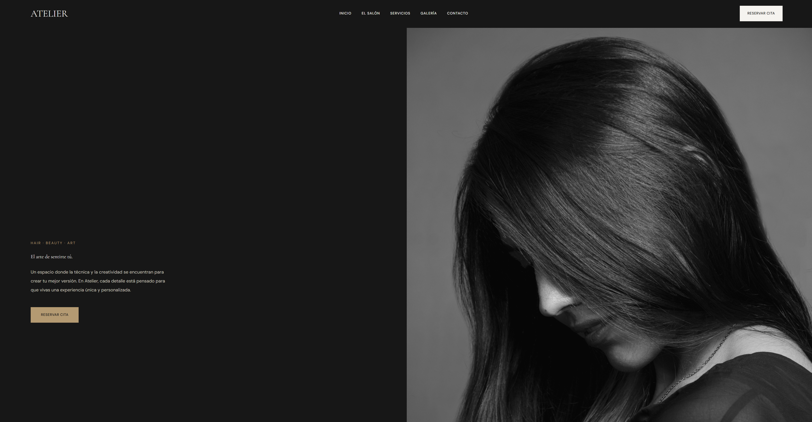
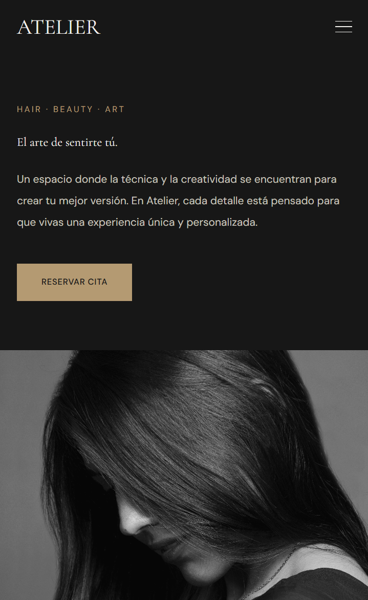

# ATELIER — Luxury Hair Studio

A modern and responsive website concept for a luxury hair studio based in Valencia, Spain.

ATELIER is a fictional hair salon project designed to explore a minimalist visual identity and an elegant digital experience, combining editorial aesthetics with a clean and responsive interface.

## Preview

<!-- Add your desktop and mobile screenshots here -->

| Desktop | Mobile |
|:----------------------:|:------------------------:|
|  |  |

**Live Demo:** [Visit ATELIER](YOUR_VERCEL_URL)

## About the Project

ATELIER is a front-end web development project focused on creating a visually engaging and responsive landing page for a fictional luxury hair studio.

The design combines dark tones, neutral colors, elegant typography and professional hair photography to create a refined visual experience.

## Features

- Responsive design for desktop and mobile devices.
- Interactive navigation with a mobile menu.
- Hero section with responsive imagery.
- Salon introduction and services sections.
- Hair styling image gallery.
- Customer testimonial section.
- Interactive appointment request form with confirmation message.
- Contact information and footer.

## Technologies

- **React** — UI development.
- **TypeScript** — Type-safe JavaScript.
- **Vite** — Development server and build tool.
- **Tailwind CSS** — Styling and responsive layouts.
- **Figma** — UI design and prototyping.

## Design

The website was designed in Figma before implementation.

The visual identity is based on a minimalist editorial style, using a dark and neutral color palette.

**Color palette:**
- Noir: `#171717`
- Ivory: `#F5F3EF`
- Stone: `#C8C5BF`
- Grey: `#85817B`
- Champagne: `#B49A72`

**Typography:**
- Cormorant Garamond
- DM Sans

## Getting Started

To run the project locally, follow these steps.

### Prerequisites

- Node.js
- npm

### Installation

1. Clone the repository:

   ```bash
   git clone https://github.com/AncutaIorga/atelier.git
   ```

2. Navigate to the project directory:

   ```bash
   cd atelier
   ```

3. Install dependencies:

   ```bash
   npm install
   ```

4. Start the development server:

   ```bash
   npm run dev
   ```

5. Open the local URL displayed in your terminal.

### Production Build

To generate the production build:

```bash
npm run build
```

The generated files will be available in the `dist` directory.

## Project Structure

```text
atelier/
├── public/
│   └── images/
│       ├── desktop/
│       └── mobile/
├── src/
│   ├── components/
│   │   ├── Header.tsx
│   │   ├── Hero.tsx
│   │   ├── About.tsx
│   │   ├── Services.tsx
│   │   ├── Gallery.tsx
│   │   ├── Testimonials.tsx
│   │   ├── Contact.tsx
│   │   └── Footer.tsx
│   ├── App.tsx
│   ├── index.css
│   └── main.tsx
├── index.html
├── package.json
└── vite.config.ts
```

## Notes

ATELIER is a fictional concept project created for portfolio and educational purposes.

The appointment form is a front-end demonstration. It displays a confirmation message but does not send or store appointment requests.

Contact details and business information shown on the website are fictional.

Images used in the project are sourced from Pexels.

## Author

Developed as a personal front-end portfolio project.